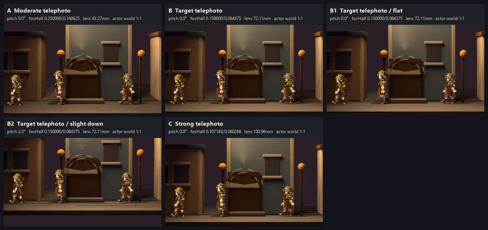

# Town camera-only perspective study

Date: 2026-08-20  
Source scene: `renders/town-pilot.blend` (preferred authored town environment)  
Study scope: camera only; no geometry, lighting, actor placement, materials, composition, permanent camera defaults, or gauntlet rerun changed.

## Contact sheet

[Open the five-render contact sheet](./town-camera-perspective-study-contact-sheet.png)

All panels are native 426x240 renders of the same scene. Actor world locations, feet anchors, and object scales were snapshotted before the study and asserted identical after every candidate render. The existing billboard planes are rotated temporarily to face each candidate camera; this corrects their old 30° camera-facing tilt without changing placement or the authored 1:1 actor/environment scale. The actor image datablock was relinked in memory to the real `projects/hichaukitoden-game/assets/character/walker.png` because the saved blend's relative path is stale when reopened; the blend was not saved.

## Calibration method

Candidate records were emitted by the real `presentation.world_camera_calibration.resolve()` path using the existing first-person session, `focusOverride` dolly/FOV/pitch values, and the existing 426x240 projection frame. Blender consumed each record through `tools/blender/thestra_camera.py:create_or_update_camera`.

The reference walking-plane depth is explicit: focal doorway x=8.5 minus the current Thestra eye x=5.5 = 3.0 world units. Candidate eye x is `8.5 - scale * 3.0`. The y/z eye coordinates remain `(5.5, 0.5)`. Principal point remains `(213, 70)`, and projection-window offsets remain `(0, 0)` for every render.

## Candidate parameters

| ID | Candidate | Eye `(x, y, z)` | Pitch | `fovHalfX / fovHalfY` | Derived Blender lens |
| --- | --- | --- | ---: | ---: | ---: |
| A | Moderate telephoto, 3x | `(-0.5, 5.5, 0.5)` | 0° | `0.25 / 0.140625` | 43.26760483 mm |
| B | Target telephoto, 5x | `(-6.5, 5.5, 0.5)` | 0° | `0.15 / 0.084375` | 72.11267853 mm |
| B1 | B flat repeat | `(-6.5, 5.5, 0.5)` | 0° | `0.15 / 0.084375` | 72.11267853 mm |
| B2 | B with slight downward pitch | `(-6.5, 5.5, 0.5)` | 2.5° | `0.15 / 0.084375` | 72.11267853 mm |
| C | Strong telephoto, 7x | `(-12.5, 5.5, 0.5)` | 0° | `0.10714285714285714 / 0.06026785714285714` | 100.95774841 mm |

The derived lens uses the shared calibration bridge's 36 mm sensor width. B and B1 are intentionally identical flat-pitch controls; they exist as separate requested panels, not as separate optical settings.

## Selection

**Selection: A — 3x moderate telephoto at 0° pitch.**

A is the preferred balance after preserving the actor/environment 1:1 world relationship: it removes the original wide-angle exaggeration while preserving enough depth separation and readable stage space. B/B1 and C remain available as the stronger-compression controls; B2 remains the slight-grounding variant.

This is a study recommendation only. No candidate was written back to [renders/town-pilot.blend](../renders/town-pilot.blend), `thestra-town-camera.json`, or any permanent runtime camera default.

## Artifacts and verification

- Contact sheet: [town-camera-perspective-study-contact-sheet.png](./town-camera-perspective-study-contact-sheet.png)
- Exact candidate records: [camera-study-records.json](./camera-study-records.json)
- Exact render report and actor snapshot: [camera-study-report.json](./renders/camera-study-report.json)
- Native renders: [A.png](./renders/A.png), [B.png](./renders/B.png), [B1.png](./renders/B1.png), [B2.png](./renders/B2.png), [C.png](./renders/C.png)
- All five images verified at 426x240.
- Each 24x48 source frame remains nearest-filtered at its authored world scale; the report records its native output footprint per candidate and no study-time object rescaling is used.
- No permanent camera or scene file was saved by the study.
